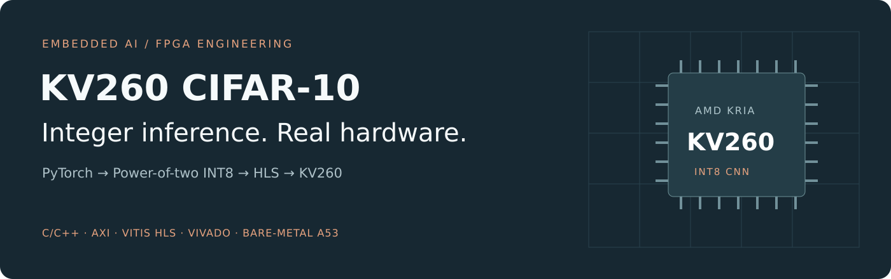
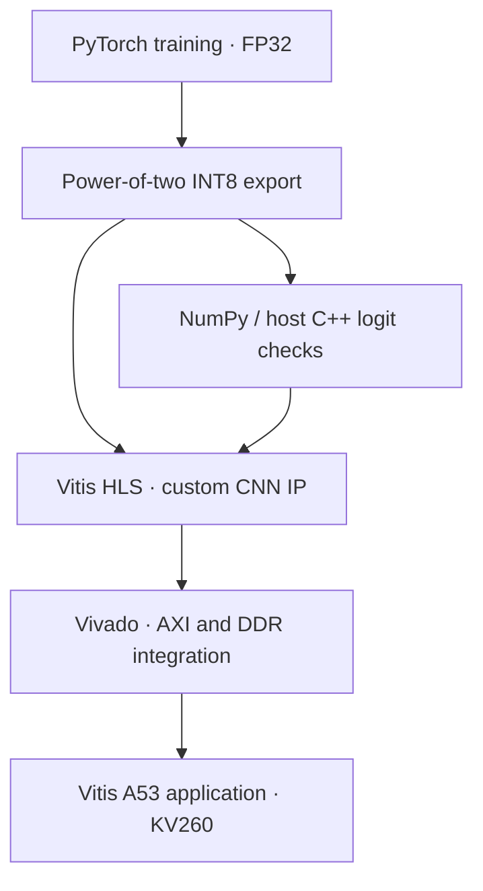

<p align="center">
  
</p>

# KV260 CIFAR-10 INT8 FPGA Inference

[](https://github.com/Davorin51/kv260-cifar10-int8-fpga-inference/actions/workflows/checks.yml)


**A CNN deployment project connecting model training, integer arithmetic, HLS design and bare-metal FPGA integration.**

A compact CIFAR-10 classifier is trained in PyTorch, quantized with power-of-two scales, checked against a NumPy integer reference, and implemented as a custom accelerator for the AMD/Xilinx Kria KV260. The ARM application manages DDR buffers, AXI control, cache maintenance and timing.

[Results & provenance](docs/results.md) · [Reproduce the workflow](docs/usage.md) · [Architecture](docs/architecture.md) · [Hardware integration](docs/hardware.md) · [Portfolio](https://davorin51.github.io/)

## Project highlights

| Area | Result or capability |
|---|---|
| Model | SmallCifarCNN_v1 · 3 convolution blocks · **24,234 parameters** |
| Arithmetic | INT8 weights/activations · INT32 bias, accumulation and output logits |
| Reference validation | All ten logits checked for both committed images and a replay |
| Hardware interface | AXI master input/output, AXI-Lite control, raw RGB input LUT |
| HLS evidence | Committed synthesis metrics and historical flow-summary records |
| Verification | NumPy arithmetic checks, compiled C++ parity, intentional-mismatch rejection, CI |

## Reported results

| Metric | Value | Evidence and scope |
|---|---:|---|
| FP32 accuracy | **74.50%** | Historical owner-reported CIFAR-10 result |
| INT8 accuracy | **72.74%** | Historical owner-reported result; existing HLS guide identifies validation accuracy |
| Reported accuracy-value difference | **1.76 percentage points** | Arithmetic difference; original paired evaluation files are not committed |
| Observed KV260 latency | **≈29.19 ms/image** | Reported start-to-done observation, including MMIO/poll overhead |
| Approximate inference rate | **≈34.3 images/s** | Consistent with reciprocal observed latency; not a camera-pipeline throughput claim |


The values above are preserved from the owner's reported results, also published in their [GitHub profile README](https://github.com/Davorin51/Davorin51/blob/main/README.md). The original FP32 checkpoint, evaluation CSV and UART benchmark log are not committed. These figures are **not newly reproduced training or hardware results**, and should not be presented as a controlled official-test-set comparison. The new CI checks validate arithmetic and logit parity, not classification accuracy.

Every figure has a machine-readable source: [reported metrics](results/reported_metrics.json), [HLS metrics](results/hls_metrics.json) and [model complexity](results/model_complexity.json). See [results and measurement boundaries](docs/results.md) for the details.

## From model to hardware



This is a custom C/C++ accelerator workflow. It does not use a Vitis AI DPU or an automatically generated PyTorch quantized model. Learned weights become constants in the IP: changing them requires rebuilding the hardware.

## HLS synthesis snapshot

The committed report estimates **2,918,914 cycles** for one image. At the configured **10 ns target period**, that corresponds to **29.18914 ms**. The reported top-level initiation interval is **2,918,915 cycles**; an `II=1` pragma inside a MAC loop does not mean one image per cycle.

| Resource | HLS estimate | Capacity listed by report | Utilization |
|---|---:|---:|---:|
| LUT | 6,758 | 117,120 | 5.77% |
| Flip-flops | 7,105 | 234,240 | 3.03% |
| BRAM 18K | 27 | 288 | 9.38% |
| DSP | 5 | 1,248 | 0.40% |


Source: [`hls_data.json`](HLS/cifar10_cnn/cifar10_cnn/hls/hls_data.json), top function `cifar10_cnn`. These are **HLS estimates**, not measured post-route utilization for the entire Vivado design. The archived report has a 7.300 ns timing estimate; it does not establish an achieved board Fmax.

[Compare the latency scopes](docs/assets/latency.png) · [Inspect workload by layer](docs/assets/workload.png)

## Try the offline checks

No board, training download or AMD tool installation is required for this path. Use Python 3.11+ and a C++14 compiler (`g++`).

```bash
git clone https://github.com/Davorin51/kv260-cifar10-int8-fpga-inference.git
cd kv260-cifar10-int8-fpga-inference
python -m venv .venv
# Linux / macOS:
source .venv/bin/activate
# Windows PowerShell: .venv\Scripts\Activate.ps1
python -m pip install -r requirements-reporting.txt
python tools/check_project.py
```

Expected output includes:

```text
MATCH sample=0 prediction=6 label=6
MATCH sample=1 prediction=5 label=5
MATCH sample=0 prediction=6 label=6 (replay)
PASS: all 10 INT32 logits match for every sample and replay.
PASS: deliberately incorrect sample-0 logit rejected.
```

The checker compiles the actual CNN and committed parameters in a temporary directory. It then deliberately corrupts sample 0's expected output and verifies that the test fails. A successful host test does not execute HLS pragmas or RTL.

For NumPy-only arithmetic checks:

```bash
python quantize_cifar10_hls.py --self-test
```

## Generate the graphs

```bash
python tools/generate_report.py
```

This regenerates four PNG/SVG figures from documented measurements, committed HLS metrics and the model's layer dimensions. It does not train a network, execute hardware or reconstruct missing measurements.

When you have a real training run, add its actual history:

```bash
python tools/generate_report.py --history runs/cifar10_01/history.csv
```

Training curves are intentionally omitted from this snapshot because no `history.csv` is committed. The optional command plots the recorded training/validation accuracy and loss, without inventing epochs.

## Repository guide

| Location | Contents |
|---|---|
| [`train_cifar10_hls.py`](train_cifar10_hls.py) | CNN, stratified train/validation split, training, model exports and test evaluation |
| [`quantize_cifar10_hls.py`](quantize_cifar10_hls.py) | NumPy FP32/INT8 references, calibration, overflow checks and C header export |
| [`HLS/cifar10_cnn/`](HLS/cifar10_cnn/README.md) | Synthesizable CNN, golden vectors, model constants and HLS preparation |
| [`Vivado/`](Vivado/) | Existing AXI block-design sources and IP configuration |
| [`Vitis/cifar10_app/src/main.c`](Vitis/cifar10_app/src/main.c) | A53 standalone correctness and timing application |
| [`tools/`](tools/) | Offline verification and graph generation |
| [`results/`](results/) | Reported measurements and reproducible derived snapshots |
| [`docs/`](docs/usage.md) | Workflow, architecture, hardware guidance and visual results |

The repository retains historical generated HLS/RTL artifacts to preserve the existing implementation evidence. Start with the source files and guides above; compiled files in those archived directories are not portable releases.

## Validation boundaries

GitHub Actions runs Python syntax checks, NumPy numerical checks, host C++ golden-vector/replay tests and report regeneration on Python 3.11 and 3.12. Historical AMD flow summaries are committed, but CI does not rerun Vitis HLS, Vivado, RTL co-simulation or the board benchmark.

The sequential accelerator is a transparent starting point for further optimization. There is no CPU/GPU speedup claim, power-efficiency claim, latency distribution or guarantee of production reliability without additional measurements.

---

Built by [Davorin Milicevic](https://github.com/Davorin51) · Software engineering, machine learning and embedded AI · [Portfolio](https://davorin51.github.io/)
