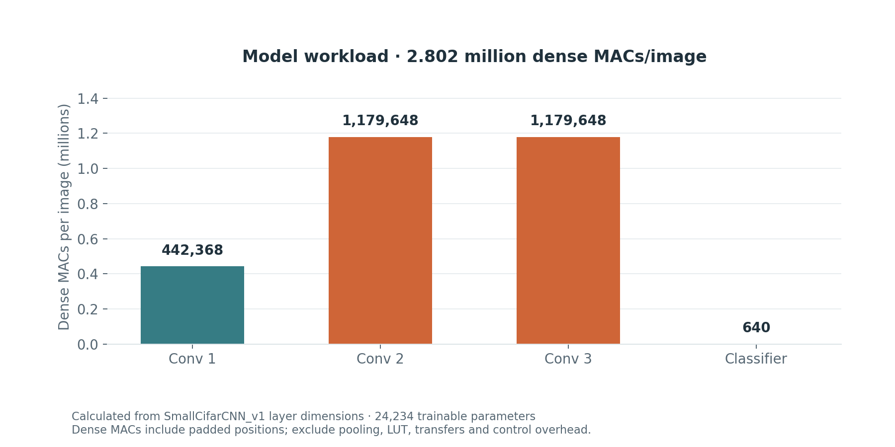

# Architecture and integer arithmetic

## Model graph

Input is one RGB image, 32×32 pixels. PyTorch uses NCHW tensors; the accelerator receives 3,072 interleaved HWC bytes.

| Stage | Operation | Output shape, excluding batch | Parameters | Dense MACs |
|---|---|---|---:|---:|
| Input | RGB LUT → CHW | 3×32×32 | — | — |
| Conv 1 | 3→16, 3×3, pad 1 → ReLU → MaxPool 2 | 16×16×16 | 448 | 442,368 |
| Conv 2 | 16→32, 3×3, pad 1 → ReLU → MaxPool 2 | 32×8×8 | 4,640 | 1,179,648 |
| Conv 3 | 32→64, 3×3, pad 1 → ReLU → MaxPool 2 | 64×4×4 | 18,496 | 1,179,648 |
| GAP | Average over 4×4 | 64 | — | — |
| Classifier | Linear 64→10 | 10 logits | 650 | 640 |
| Total | | | **24,234** | **2,802,304** |

Counts come from source-layer dimensions, not a hardware profiler. Dense MACs include padded-zero positions and exclude pooling, LUT lookup, requantization, additions and memory/control overhead. The reported model parameters comprise 24,112 weights and 122 biases.

## Fixed-point contract

The quantizer uses `real_value = integer_value × 2^(-fractional_bits)`, with zero point zero. Weights are symmetric INT8 in [-127, 127]; post-ReLU activations are [0, 127]. Biases and output logits use INT32. NumPy accumulates in INT64 to check INT32 bounds before export.

- RGB normalization is `(pixel / 255 - 0.5) / 0.5`. A 256-entry LUT implements its quantized version on hardware with input fractional bits 6.
- Convolution is cross-correlation: stride 1, padding 1, OIHW weight order.
- Requantization uses `input_frac + weight_frac - output_frac`; positive shifts round right, negative shifts left, then saturate.
- Rounding is nearest with ties away from zero; after ReLU, the right-shift helper uses a positive half-step offset.
- Max pooling follows ReLU/requantization. HLS computes four convolution pixels for each pooled output, avoiding a full unpooled map.
- GAP is exactly `(sum + 8) >> 4` over 16 nonnegative INT8 values.
- The ten INT32 classifier logits share one scale, so argmax needs no dequantization or softmax.

## Storage and scheduling

Convolution blocks run sequentially. CHW input and intermediate buffers are bound to BRAM through HLS pragmas and fully overwritten on each invocation. Exported weights are compile-time constants. `II=1` on an inner loop is a requested initiation interval for that loop, not a whole-image rate.

The ideal serialized parameter payload is 96,936 bytes for FP32 parameters versus 24,600 bytes for INT8 weights plus INT32 biases. These counts exclude the input LUT, alignment, activation buffers and tool mapping. They are not measurements of FPGA BRAM, compressed file size or physical implementation efficiency.

## Verification layers

| Layer | What it establishes |
|---|---|
| NumPy self-test | Convolution against a scalar reference; pooling, rounding, shifts, LUT and full integer graph |
| Host C++ golden vectors | Exact agreement of all ten logits for the committed parameters and both samples, plus replay |
| Negative host test | A deliberately incorrect sample-0 logit must be rejected |
| Historical HLS records | Flow-summary status from the owner's archived tool run |
| Board application | When run on the correct bitstream/BSP, compares every logit and reports observed/service timings |

Two matching images establish implementation agreement for those vectors. They do not establish a dataset-wide accuracy number.
