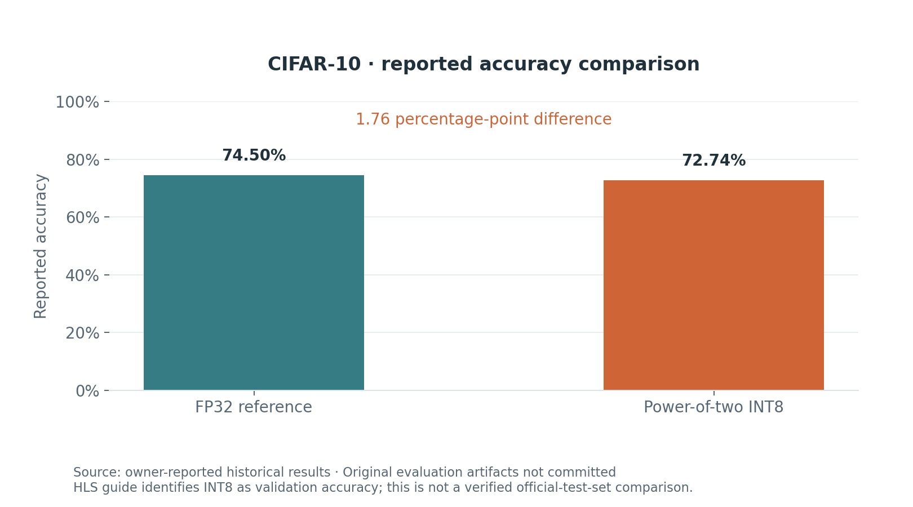
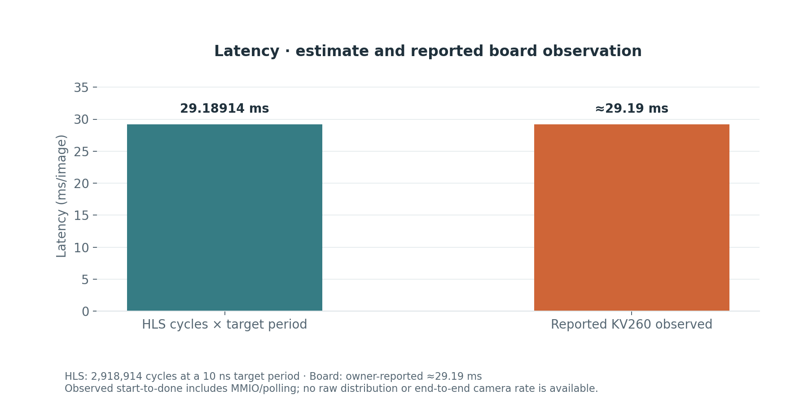
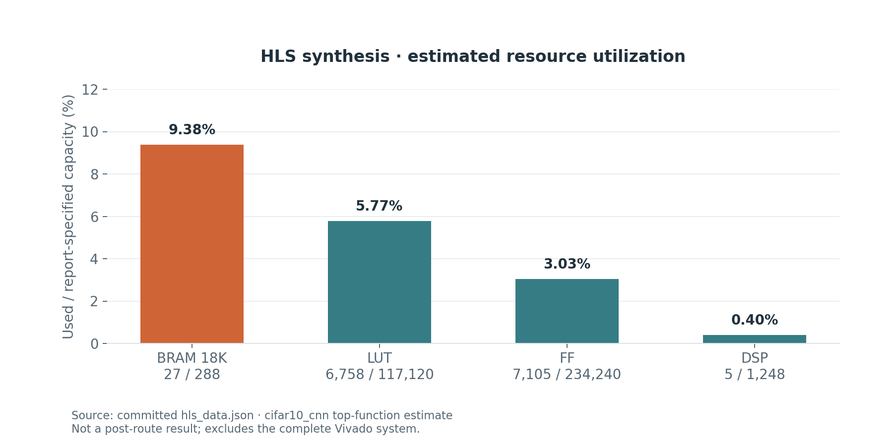

# Results and evidence

The presentation deliberately separates three sources: owner-reported historical measurements, committed HLS estimates and values calculated directly from the model graph.

## Accuracy



The owner reported FP32 74.50% and INT8 72.74%, also listed in the public GitHub profile README. The existing HLS documentation identifies 72.74% as validation accuracy. The original `comparison.json`, evaluated indices/count and FP32 checkpoint are not committed in this repository.

The 1.76 percentage-point difference is arithmetic between the reported values. It is not a newly verified quantization-loss experiment on one recorded common split. No synthetic accuracy is substituted for real CIFAR-10 evaluation.

The current training script uses 45,000 training images and 5,000 validation images, selects the best epoch on validation, then evaluates the official test set. The quantizer calibrates from the training split and compares FP32/INT8 on validation. Keep the distinction when publishing a new run.

## Latency



| Quantity | Value | Source |
|---|---:|---|
| HLS top latency | 2,918,914 cycles | Committed `hls_data.json` |
| HLS initiation interval | 2,918,915 cycles | Same report |
| Configured target period | 10 ns | Report/config |
| Calculated latency at target clock | 29.18914 ms | cycles × target period |
| Reported observed board latency | approximately 29.19 ms | Owner's historical measurement |
| Reported approximate rate | approximately 34.3 images/s | Owner-reported; consistent with reciprocal latency |

The A53 application defines two intervals:

- **IP observed:** start-register write to observed `done`, including MMIO and polling overhead.
- **Service:** image copy, output initialization, cache maintenance, register setup, start/poll and output invalidation. Excludes image acquisition and preprocessing outside the application.

UART prints and logit comparison are outside those timed intervals. `RUNS=100` is the current benchmark configuration; an original per-call UART log is not committed. Consequently, no p50/p95, histogram, standard deviation or independently verified full-pipeline throughput is plotted.

The close numerical agreement between the HLS calculation and the reported observation is descriptive. It is not proof of an achieved post-route frequency or a CPU/GPU speedup.

## Resources



Resource counts and capacities come from `ModuleInfo.Metrics.cifar10_cnn.Area`. Percentages are calculated from those integer counts rather than the report's rounded utilization strings. The report gives an estimated 7.300 ns period with a 10.00 ns target and 2.70 ns uncertainty. Do not infer actual board Fmax from that estimate.

The estimate covers the HLS top function. It excludes the complete system, including processor subsystem, AXI interconnect and other Vivado IP, and is not a post-route report.

## Archived tool evidence and current checks

The `*.hls*_summary` files contain JSON records wrapped in `<ENTRY>` sections; they are not one JSON document. Archived C simulation, compilation, co-simulation and packaging files contain `CS_PASSED` status records. Refer to those original files when auditing the historical flow.

The previously committed C++ testbench only executed sample 1 despite describing full-sample/replay verification. The portfolio update restores the intended loop, and the host checker now verifies both exported images, sample 0 replay and deliberate rejection of a wrong sample-0 output. This does not retroactively expand coverage of the historical RTL run.

## Reproduce the figures

```bash
python -m pip install -r requirements-reporting.txt
python tools/generate_report.py
python tools/check_project.py
```

The generator refreshes `results/hls_metrics.json` with the raw-report SHA-256, `results/model_complexity.json`, and four PNG/SVG plots. `results/reported_metrics.json` holds the separately labelled historical values and limitations.

To add actual training curves, supply a run's `history.csv` with epoch, train/validation loss and train/validation accuracy columns. The generator rejects empty, non-finite, duplicate or out-of-order epoch data. No training history, raw latency log, post-route utilization, power measurements or board bitstream is fabricated by these tools.
